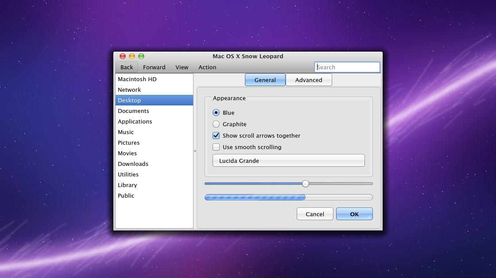

# Mac OS X themes for KDE Plasma 6

Ten global themes for KDE Plasma 6, one for each Mac OS X release from 10.0 Cheetah to 10.9 Mavericks.
Each one includes a window decoration, Plasma style, colour scheme, Kvantum widget style, wallpaper,
and a layout with a menu bar and dock.

**Project page with screenshots: https://demuthpetr.github.io/snow-leopard-plasma/**



Everything except the optional Mac4Lin part is generated from scratch by Python scripts
(Pillow, plus rsvg-convert for previews). No AUR packages are needed and no third-party themes are downloaded.

## Requirements

- KDE Plasma 6 (tested on 6.8, Arch Linux, Wayland)
- `python` and `python-pillow`, plus `librsvg` for `rsvg-convert`
- `kvantum` for the Aqua widgets (in Arch's `extra` repo). In System Settings › Colours & Themes ›
  Application Style, choose **kvantum**.
- optional: `python-pyqt6`, only for regenerating the page screenshots (`shots.py`)

## Snow Leopard

| Part | Where it lands |
|---|---|
| Window decoration (Aurorae): unified grey title bar, glossy traffic lights, soft shadow | `~/.local/share/aurorae/themes/SnowLeopard` |
| Plasma style: translucent menu bar, glass-shelf dock, white popups | `~/.local/share/plasma/desktoptheme/SnowLeopard` |
| Colour scheme | `~/.local/share/color-schemes/SnowLeopard.colors` |
| Kvantum widget style: Aqua buttons, blue jelly scrollers, barber-pole progress bars | `~/.config/Kvantum/SnowLeopard` |
| Wallpapers "Snow Leopard Aurora", "Galaxy", "Graphite" (original, generated) | `~/.local/share/wallpapers/` |
| Global theme with menu bar + dock layout and a grey boot splash | `~/.local/share/plasma/look-and-feel/org.snowleopard.desktop` |

```
./install.sh                 # build if needed, copy files only
./apply.sh                   # apply + replace panels with menu bar and dock
./apply.sh --keep-layout     # apply but keep your panels
```

Without Kvantum, the theme falls back to Breeze widgets with the Snow Leopard colours.
If the WhiteSur icon theme is installed, the theme uses it. Otherwise it uses Oxygen.

## Mac4Lin (Leopard): optional, bring your own pack

`mac4lin_gen.py` converts the 2009 Mac4Lin pack into a Plasma 6 global theme. The pack contains Apple
artwork (icons, cursors, sounds, Lucida Grande), so it is **not included in this repository**. Download
`Mac4Lin_Install_v1.0.zip` from <https://sourceforge.net/projects/mac4lin/files/> and put it in `vendor/`.
The converter only extracts the artwork. It never runs the pack's scripts or binaries.

- original Leopard icons with KDE name aliases (Finder → Dolphin, Terminal → Konsole, …)
- Leopard cursors, system sounds, Lucida Grande, the Aurora and Grass wallpapers
- Aurorae window frame built from the Emerald pixmaps and traffic-light buttons
- Kvantum variant whose toolbar continues the frame's title gradient

```
./install-mac4lin.sh         # copy files only
./apply-mac4lin.sh           # apply (keeps your panels; --reset-layout for menu bar + dock)
./apply.sh --keep-layout     # back to Snow Leopard
```

## Every release from 10.0 Cheetah to 10.9 Mavericks

`versions.py` builds eight more global themes. Leopard is the Mac4Lin theme and Snow Leopard is the one above.
Colours were sampled from period screenshots, and all textures and wallpapers are generated:

| Version | Windows | Menu bar | Dock | Wallpaper |
|---|---|---|---|---|
| 10.0 Cheetah, 10.1 Puma, 10.2 Jaguar | pinstripes, glossy Aqua, jelly scrollers | pinstriped white | flat, pinstriped, ▲ indicators | blue Aqua swooshes |
| 10.3 Panther, 10.4 Tiger | brushed metal | glossy white | flat white, ▲ indicators | blue Aqua swooshes |
| 10.7 Lion, 10.8 Mountain Lion | unified grey, flatter buttons, overlay scrollbars | light grey | glass shelf | spiral galaxy |
| 10.9 Mavericks | as Lion, lighter | translucent | shallow frosted shelf | ocean wave |

```
./install-versions.sh                     # copy files only (run install.sh first)
./apply-version.sh tiger                  # cheetah puma jaguar panther tiger leopard snowleopard lion mountainlion mavericks
./apply-version.sh mavericks --reset-layout
```

If the Mac4Lin pack is installed, every version uses its icons, cursors, sounds and Lucida Grande.

## Tweaking

To tweak colours or sizes, edit `palette.py` or the generators, then run `python3 build.py && ./install.sh`
(or `python3 versions.py && ./install-versions.sh`). `python3 shots.py` re-renders the screenshots in
`docs/img/` off-screen from the installed themes.

## License and trademarks

The code and everything it generates are licensed under the GPL-3.0 (see `LICENSE`). This is an unofficial fan project and is not
affiliated with or endorsed by Apple Inc. Mac OS X, Aqua and the release names are trademarks of Apple Inc.,
and are used here only to describe which look each theme recreates.
